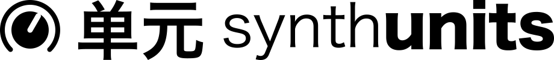

<picture>
  <source media="(prefers-color-scheme: dark)" srcset="synthunits-white.svg">
  
</picture>

**Little Eurorack building blocks**, made by [Jeremy Seitz](https://somebox.com) in Luzern, Switzerland.

**The site: [somebox.github.io/synthunits](https://somebox.github.io/synthunits/)**: every module with its renders, block diagram,
schematic, connections and limits, and where each one stands.

This repository holds the site and is where feedback goes. The design files live elsewhere and aren't open source
yet; I may open them once the circuits are proven.

## Follow along

- **Star** this repository and **watch** it (Custom → Discussions) to hear about the first boards and, later, a first
  production round.
- **[The progress board](https://github.com/somebox/synthunits/projects)** shows each module's state, from design through bring-up to production.
- On Mastodon: [@somebox@swiss.social](https://swiss.social/@somebox).

## Tell me what you think

- **Which modules would you use?** Give a module's [tracking issue](https://github.com/somebox/synthunits/issues) a thumbs-up, or fill in the
  [interest form](https://github.com/somebox/synthunits/issues/new/choose): tick the modules, kit or built. That's how I'll choose what goes into the first
  production round.
- **Ask for a module** with a [module request](https://github.com/somebox/synthunits/issues/new/choose).
- **Questions and ideas** go to the [discussions](https://github.com/somebox/synthunits/discussions).

Nothing is for sale yet. The first boards are a test run: I build and measure them before anyone pays for one.
